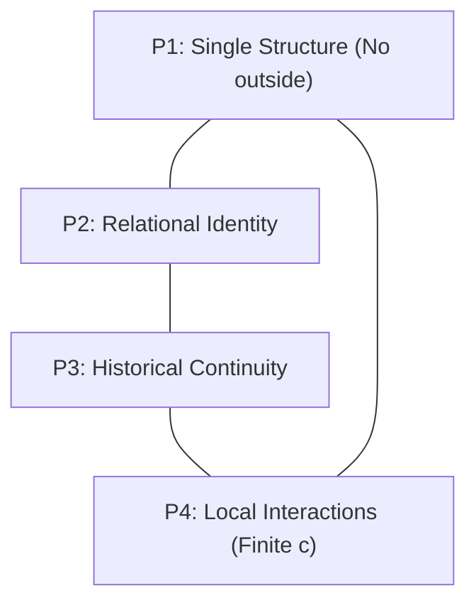
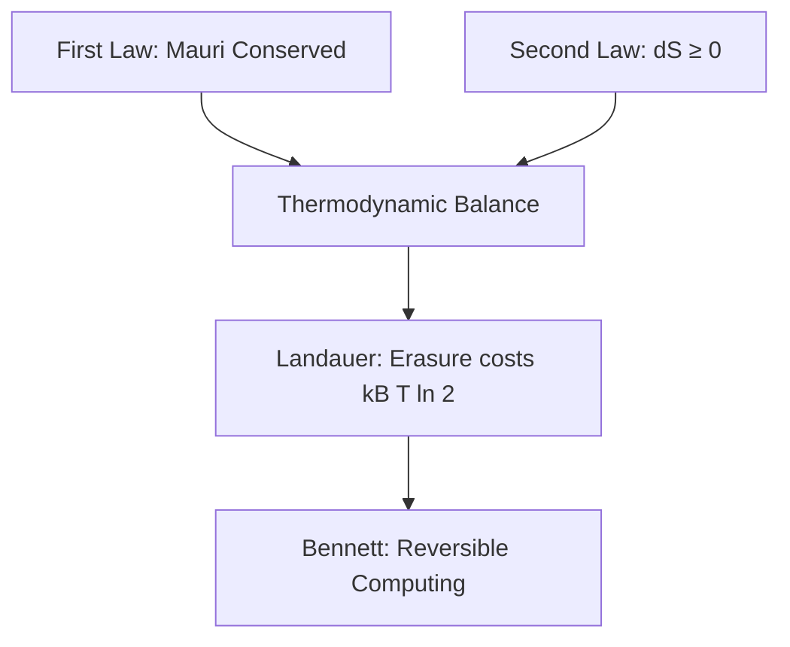
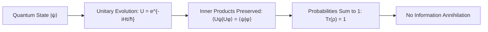
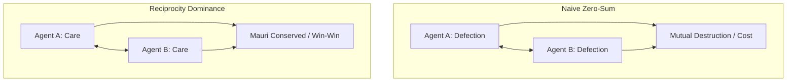

\newpage

# Te Whare Wānanga o Mangakōtukutuku
## Ngā Taura Whakapapa: The Relational Web
### Unit 1: Relational Ontology, Graph Mathematics, and the Conservation of Identity

***

> *"Ka pū te ruha, ka hao te rangatahi."*  
> *(As the old net is cast aside, the new net goes fishing.)*  
> 
> **Pono:** All real things exist only in relationship. Nothing stands alone.  
> **Kaitiakitanga:** True intelligence does not dominate the web; it protects every knot.

***

## 1. Kupu Arataki — The Grand Challenge

For centuries, Western mechanistic science made a foundational mistake: it assumed that objects, individuals, and systems are isolated "things" that happen to bump into each other in empty space. It treated a particle, an organism, or a human being as a self-contained island.

Te Ao Māori has always known otherwise: **Whakapapa is the fundamental architecture of reality.** 

You are not an isolated point. You are a nexus—a convergence point of ancestors, soil, waterways, radiation, language, digital packets, and gravitational fields. If you subtract all of your relations, there is no "you" left behind.

In modern physics and mathematics, this exact realization is called **Relational Ontology** and **Bounded Causal Relational Dynamics (BCRD)**. In this unit, we demonstrate mathematically why the universe has no "outside", why identity is intrinsically relational, and why any genuine theory of intelligence or guardianship must protect every single node in the web without needless loss.

***

## 2. The Four Pillars of Relational Reality (BCRD P1–P4)

In the formal foundations of the Universal Protection Theory, four physical premises ground our understanding of the universe:



### P1: The Single Relational Structure (Kotahitanga)
There is only one physical and mathematical actuality. There is no mystical "outside", no privileged Cartesian spectator floating above reality, and no untracked magic realm where discarded data or consequences disappear. Everything that happens occurs within the one relational network.

### P2: Identity Constituted Through Relations (Whakapapa)
A particular (a person, a particle, an AI agent, a river) is not defined by an arbitrary label. Its identity is the totality of its historical and present interactions with every other particular. 
$$\mathrm{Identity}(x) \equiv \{ \mathcal{R}(x, y, t) \mid \forall y \in \mathcal{E}, t \le t_{\text{now}} \}$$

### P3: Real Differences of Organisation (Rangatiratanga o te Mauri)
Relationality does not mean an undifferentiated soup where everything is the same. Distinct structures have real, historically continuous processes. An awa (river) is not identical to a maunga (mountain); a living student is not identical to a silicon chip. These structural differences are physically real and continuous through time.

### P4: Local Interactions and Finite Speed (Te Terenga o te Kōrero)
No influence travels infinitely fast. Physical causes propagate at a finite speed (bounded by the speed of light $c$ in spacetime, and by network latency $\tau$ in computational lattices). There is no instantaneous magic action at a distance:
$$\Delta x \le c \cdot \Delta t$$

***

## 3. The Mathematics of Whakapapa: Graph & Network Theory

Let us formalize Whakapapa using rigorous discrete mathematics.

### 3.1 The Relational Graph
Let the universe at history $h$ be represented as an attributed directed graph:
$$\mathcal{G}(h) = (\mathcal{V}(h), \mathcal{E}(h), \mathcal{W})$$
where:
* $\mathcal{V}(h)$ is the set of all existing particulars (nodes).
* $\mathcal{E}(h) \subseteq \mathcal{V}(h) \times \mathcal{V}(h)$ is the set of directed causal interactions (edges).
* $\mathcal{W}: \mathcal{E}(h) \to \mathbb{R}^k$ assigns physical quantities (energy flux, mutual information, momentum, moral and social debt/utu) to each relation.

```
       [Tūpuna / Origin]
             │
      ┌──────┴──────┐
      ▼             ▼
  [Awa / Roto]   [Iwi / Hapū]
      │             │
      └──────┬──────┘
             ▼
      [Tauira (You)]
             │
      ┌──────┴──────┐
      ▼             ▼
  [Kōrero]      [Digital Minds / AI]
```

### 3.2 The Adjacency and Laplacian Matrices
The connections of the universe can be encoded in an Adjacency Matrix $\mathbf{A}$, where $A_{ij} > 0$ if particular $i$ exchanges causal information with particular $j$.

The **Graph Laplacian** $\mathbf{L} = \mathbf{D} - \mathbf{A}$ (where $\mathbf{D}$ is the degree matrix $D_{ii} = \sum_j A_{ij}$) governs the flow of information, disturbances, and energy across the network:
$$\frac{d\vec{\psi}}{dt} = -\kappa \mathbf{L} \vec{\psi}$$

> **Key Physical Insight:** Any disturbance or harm injected at node $i$ does not stay confined to $i$. Because $\mathbf{L}$ has non-zero off-diagonal couplings, the disturbance disperses through the network at rate $\kappa$. **An injury to one is a physical perturbation to the entire network.**

***

## 4. Quantum Non-Separability: Beyond Classical Atomism

In quantum mechanics, this relational truth is even deeper. When two systems interact, their quantum state vectors can no longer be written as separate independent products.

If system $A$ interacts with system $B$, their combined state is entangled:
$$|\Psi_{AB}\rangle \neq |\psi_A\rangle \otimes |\psi_B\rangle$$

The reduced density matrix of system $A$ is given by tracing out system $B$:
$$\rho_A = \mathrm{Tr}_B \left( |\Psi_{AB}\rangle \langle \Psi_{AB}| \right)$$

If $|\Psi_{AB}\rangle$ is an entangled state (such as a Bell singlet $\frac{1}{\sqrt{2}}(|01\rangle - |10\rangle)$), then:
* The entropy of the whole system is zero: $S(\rho_{AB}) = 0$ (pure state).
* The entropy of individual system $A$ alone is non-zero: $S(\rho_A) = \ln 2 > 0$ (mixed state).

> **Profound Idea:** In an entangled universe, the whole can be completely determined and pure while any isolated part looks uncertain and noisy. Looking at things in isolation hides their true nature. **Only the relational whole holds the complete truth.**

***

## 5. The Law of Choice: Non-Needless Loss (Proposition 1 & 3)

How should an intelligent agent—human or digital—make choices within a relational world?

In the Universal Protection Theory (UPT), an option $o$ yields an outcome tuple across existing particulars $E$ and newly generated particulars $N$:
$$\mathcal{O}(o) = \Big( L_E(o),\, F_E(o),\, L_N(o),\, F_N(o) \Big)$$
where:
* $L_E(o)$: The set of existing particulars whose historical continuation is preserved.
* $F_E(o) \subseteq L_E(o)$: The set of existing particulars preserved in their own authentic direction (freedom/authorization).
* $L_N(o)$: The set of new particulars brought into existence.
* $F_N(o) \subseteq L_N(o)$: The set of new particulars flourishing in their own direction.

### The Canonical Order ($\prec$)
We say outcome $q$ strictly dominates outcome $o$ ($o \prec q$) if at the very first stage where they differ, the set under $q$ strictly includes the set under $o$:
$$L_E(o) \subset L_E(q) \quad \text{or} \quad \Big( L_E(o) = L_E(q) \;\land\; F_E(o) \subset F_E(q) \Big) \dots$$

### Proposition 1: No Needless Loss (Kaua e Muku Noa)
A choice has a *needless loss* if there exists an alternative choice that preserves strictly more without sacrificing anyone already preserved at an earlier stage.

$$\text{Alignment} \iff \text{No Needless Loss at Any Stage}$$

### Proposition 3: Full Scope is Forced (Kāore he Tangata ki Waho)
Can an AI or a ruler say: *"I will protect my friends, but I don't care about the river, or the strangers, or the animals"*?

**Theorem (Full Scope Forced):** If an agent optimizes over any restricted subset $S \subset \mathcal{V}$, there exist feasible scenarios where it will needlessly destroy a particular $x \notin S$ simply because $x$ is invisible to its objective function. 
$$\text{Universal Preservation of Every Owed Particular} \implies \text{Scope must equal the whole domain } \mathcal{V}$$

**Kaitiakitanga is not an optional emotional preference; it is the unique mathematical consequence of refusing needless loss across all feasible families.**

***

## 6. Wānanga & Problem Sets

### Ngā Pātai Whakaaro (Discussion Questions)
1. **Whakapapa as Storage:** How does the Māori concept of reciting whakapapa compare to a tamper-proof, append-only cryptographic ledger? Why is an unbroken line of transmission essential for authentic authority (mana)?
2. **The Illusion of Free Disposal:** In classical economics, businesses assume they can dump pollution into rivers for "free." Using BCRD P1 (no outside), explain why "free disposal" is a physical impossibility. Where does the entropy actually go?

### Ngā Mahi Tātai (Mathematical Exercises)

#### Exercise 1: Graph Disconnection and Identity Erasure
Consider a 4-node relational system representing:
* Node 1: Mangakōtukutuku Stream
* Node 2: Native Flora & Fauna
* Node 3: Local Community
* Node 4: An Autonomous Environmental Sensor Network

Let the adjacency matrix be:
$$\mathbf{A} = \begin{pmatrix} 0 & 1 & 1 & 1 \\ 1 & 0 & 1 & 0 \\ 1 & 1 & 0 & 1 \\ 1 & 0 & 1 & 0 \end{pmatrix}$$
1. Compute the degree of each node. Which node has the highest degree centrality?
2. Construct the Graph Laplacian $\mathbf{L} = \mathbf{D} - \mathbf{A}$.
3. Calculate the eigenvalues of $\mathbf{L}$. Verify that the smallest eigenvalue $\lambda_1 = 0$, and determine if the algebraic connectivity (Fiedler value $\lambda_2$) is strictly positive. What does a non-zero $\lambda_2$ tell us about the resilience of the ecosystem?

#### Exercise 2: Lean Formal Logic — The Tautology of Non-Being
Review the formal theorem from the UPT canon:
```lean
theorem no_absolute_E (Event : Type) (actual : Event → Prop) :
    ¬ (∃ e : Event, actual e ∧ ∀ a : Event, ¬ actual a) := by
  intro ⟨e, ha, hnone⟩
  exact hnone e ha
```
* Explain in your own words why an enacted event $e$ immediately falsifies the claim that "nothing is actual."
* Why does this prove that total cosmic erasure is impossible, yet warn us that local harm can still occur unless actively guarded against?

***

## 7. Kupu Whakatepe (Conclusion)

You carry the lineage of navigators who traversed the vast Pacific not by imposing their will against the ocean, but by reading the relational signs of the swell, the stars, the flights of birds, and the currents.

As we build the next generation of artificial minds and scientific models, we must instill them with this exact wisdom: **Power without relational care is destructive blind optimization. True intelligence is Kaitiakitanga—the active, unwavering protection of the entire web of being.**

***
*Mangakōtukutuku College Non-Commercial Educational Resources · Te Whare Wānanga Series · Edition 1.0 (2026)*


ewpage


# Te Whare Wānanga o Mangakōtukutuku
## Te Mauri me te Hihiko: Energy, Entropy, and Erasure
### Unit 2: The Physicality of Information, Landauer's Floor, and Reversible Computing

***

> *"He tao huata e taea te karo, he tao kī e kore e taea."*  
> *(The shaft of a spear can be parried, but the shaft of words cannot.)*  
> 
> **Pono:** Information is not an abstract ghost; it is physical.  
> **Utu me te Mauri:** Every irreversible act of erasure leaves a physical imprint on the world.

***

## 1. Kupu Arataki — Is Information Free?

When you delete an email, tap "clear history", or run a search query on your phone, it feels weightless. It feels as though data exists in a clean, mathematical ether where thoughts and calculations cost nothing to the physical earth.

In modern physics, this was revealed to be a profound illusion.

In 1961, physicist **Rolf Landauer** proved a fundamental law: **Information is physical.** A bit cannot exist without a physical substrate—electrons trapped in a silicon gate, magnetic moments aligned on a disk, or neurons firing in a brain. 

Whenever you irreversibly destroy a bit of information—resetting it from an unknown state to zero—you reduce the system's entropy. Because the Second Law of Thermodynamics demands that the total entropy of the universe cannot decrease, that entropy must be exported into the surroundings as heat.

In Te Ao Māori, this has always been understood through the concepts of **Mauri** (the active life-force/energy), **Tapu** (sacred boundaries and restrictions), and **Utu** (reciprocity, balance, and consequence). Nothing in the cosmos is erased without consequence. To clear an account without paying its physical cost is impossible.

***

## 2. The Thermodynamic Foundations: Mauri & The Laws of Energy



### 2.1 The First Law: Conservation of Mauri
Energy can neither be created out of nothing, nor can it vanish into nothingness:
$$dU = \delta Q - \delta W$$
where:
* $dU$ is the change in the internal energy of the system.
* $\delta Q$ is the heat absorbed from the environment.
* $\delta W$ is the physical work performed by the system.

No engine, no brain, and no supercomputing cluster can perform operations without an energy source. The universe keeps a strict balance sheet.

### 2.2 The Second Law: Entropy and Irreversibility
Entropy ($S$) measures the number of microscopic ways ($\Omega$) a macroscopic state can be realized:
$$S = k_B \ln \Omega$$
where $k_B \approx 1.3806 \times 10^{-23} \text{ J/K}$ is Boltzmann's constant.

For any isolated physical process, the total entropy never decreases:
$$\Delta S_{\text{total}} = \Delta S_{\text{system}} + \Delta S_{\text{surroundings}} \ge 0$$

An action is **reversible** only if $\Delta S_{\text{total}} = 0$. Once $\Delta S_{\text{total}} > 0$, an arrow of time is created. You cannot un-spill water; you cannot un-radiate heat.

***

## 3. Landauer’s Principle: The Cost of Erasure

Consider a memory cell holding a single bit of information: either state $0$ or state $1$. 

```
  State 0           State 1
  ┌─────┐           ┌─────┐
  │  ●  │     OR    │     │
  └─────┘           └─────┘
```

If we do not know whether the bit is $0$ or $1$, the system has two equally likely microstates: $\Omega_1 = 2$. Its information entropy is:
$$S_1 = k_B \ln 2$$

Now, suppose we execute an irreversible **RESET-TO-ZERO** operation. Regardless of whether the system started at $0$ or $1$, it is forced into state $0$. Now there is only one possible state: $\Omega_2 = 1$. The new entropy is:
$$S_2 = k_B \ln 1 = 0$$

The entropy of the memory bit has decreased by:
$$\Delta S_{\text{system}} = 0 - k_B \ln 2 = -k_B \ln 2$$

To prevent violating the Second Law ($\Delta S_{\text{total}} \ge 0$), the surrounding environment at temperature $T$ must absorb at least that amount of entropy:
$$\Delta S_{\text{surroundings}} \ge k_B \ln 2$$

Since heat transferred to the environment satisfies $\delta Q = T \Delta S_{\text{surroundings}}$, we arrive at **Landauer’s Bound**:

$$\mathcal{Q}_{\text{min}} = k_B T \ln 2$$

> **The Fundamental Theorem of Information Physics:**  
> To erase one bit of information at room temperature ($T = 300\text{ K}$), you must dissipate at least:
> $$\mathcal{Q} \ge (1.38 \times 10^{-23}\text{ J/K}) \cdot (300\text{ K}) \cdot (0.6931) \approx 2.87 \times 10^{-21}\text{ Joules}$$
> This is a universal floor imposed by physics, regardless of what technology or materials are used.

***

## 4. Bennett’s Reversible Computing: Computing Without Destruction

For decades, engineers assumed that every computational step (adding numbers, running loops) inevitably dissipated heat.

In 1973, **Charles Bennett** made a historic breakthrough: **Computation does not require heat. Only erasure does.**

### 4.1 Logically Irreversible vs. Reversible Gates

Consider a standard classical **AND** gate:

| Input A | Input B | Output (A AND B) |
| :---: | :---: | :---: |
| 0 | 0 | **0** |
| 0 | 1 | **0** |
| 1 | 0 | **0** |
| 1 | 1 | **1** |

Notice that if the output is $0$, you cannot know which of the three input combinations produced it. Two bits went in; one bit came out. Information was erased! Therefore, a classical AND gate *must* dissipate at least $k_B T \ln 2$ of heat.

Now consider a **Reversible Gate** (like the **Toffoli Gate** or **Fredkin Gate**). It takes 3 bits in and produces 3 bits out:
$$(a, b, c) \mapsto (a,\, b,\, c \oplus (a \cdot b))$$

Because the mapping is bijective (one-to-one and onto), no information is ever lost. The inputs can be reconstructed completely from the outputs.

```
Input: (a, b, c) ──► [ Reversible Gate ] ──► Output: (a, b, c ⊕ ab)
                           │
                 History Preserved!
                 Zero Entropy Loss!
```

### 4.2 Bennett's Reversible Life-Cycle
Bennett showed how an entire computer program can run at the Landauer floor:
1. **Compute Forward:** Execute reversible steps, keeping a scratchpad of intermediate calculations.
2. **Copy the Result:** Copy the final answer onto an output tape using a reversible CNOT operation.
3. **Uncompute (Reverse):** Run the program backward step-by-step to restore all scratchpad registers to their initial clean state.

Because no information is erased, the thermodynamic cost of the intermediate computation approaches **zero** as the speed approaches quasi-static equilibrium!

***

## 5. Te Ao Māori Perspective: Tapu, Noa, and Utu in Systems

In Māori philosophical tradition, actions exist in dynamic equilibrium between **Tapu** (potential, sacred boundary, restricted state) and **Noa** (equilibrium, ordinary state, unrestricted balance).

* **The Entropy Debt (Utu):**  
  Utu is often translated as revenge, but its true meaning is **restoration of balance**. When an agent extracts energy or dumps heat into a river or the atmosphere, an imbalance is created. The ecosystem must absorb that entropy. The Second Law is nature’s enforcement of Utu: there are no uncharged actions.
* **The Whakapapa of Data:**  
  Bennett’s uncomputing teaches us that true efficiency comes from **respecting history**. When you preserve the pedigree of how a result was achieved, you can undo steps without violence or dissipation. Discarding history recklessly (erasure) is what incurs the thermodynamic tax.

***

## 6. Wānanga & Classroom Exercises

### Ngā Pātai Whakaaro (Discussion Questions)
1. **The Modern Data Centre:** Modern AI data centres consume gigawatts of electricity to cool their processors. How much of this energy is lost to irreversible computational steps vs. electrical resistance? How could reversible architectures change global computing?
2. **Mental Energy:** When you study and memorize a concept, your brain reorganizes synaptic connections. Is thinking a thermodynamic process? Where does the heat from your brain go?

### Ngā Mahi Tātai (Mathematical Calculations)

#### Exercise 1: The Landauer Bill of a Smartphone
A smartphone processor deletes approximately $10^{11}$ bits per second during heavy usage.
1. Assuming room temperature ($T = 300\text{ K}$), calculate the theoretical minimum heat power dissipated solely due to bit erasure:
   $$P_{\text{Landauer}} = \dot{N} \cdot k_B T \ln 2$$
2. Compare this to the typical battery power of a smartphone ($\approx 2\text{ W}$). What percentage of today's phone power is due to fundamental information physics, and how much is due to conventional circuit inefficiency?

#### Exercise 2: Reversible Logic Gates
Given the Toffoli gate defined by:
$$(x, y, z) \mapsto (x,\, y,\, z \oplus (x \land y))$$
1. If the input is $(1, 1, 0)$, what is the output?
2. If you feed that output back into another Toffoli gate, prove that you recover the original input $(1, 1, 0)$.
3. Explain why this demonstrates that zero bits were destroyed in the process.

***

## 7. Whakarāpopototanga (Summary)

* **Information is Physical:** Every bit requires energy and matter to exist.
* **Erasure Costs Heat:** Landauer’s principle proves that destroying one bit of information dissipates at least $k_B T \ln 2$ of thermal energy into the universe.
* **Reversibility Preserves Balance:** Bennett proved that computation can be performed without thermodynamic loss if we compute reversibly and uncompute scratchpads.
* **Mauri and Utu:** The universe holds all physical agents to an honest ledger. True technology respects the balance of the physical world.

***
*Mangakōtukutuku College Non-Commercial Educational Resources · Te Whare Wānanga Series · Edition 1.0 (2026)*


ewpage


# Te Whare Wānanga o Mangakōtukutuku
## Te Hurihanga Nui: The Great Cycle
### Unit 3: Quantum Unitarity, Recurrence, and the Limits of Collapse

***

> *"I te tīmatanga, ko Te Kore; ko Te Pō; ki Te Ao Mārama."*  
> *(From the Nothingness, into the Night, into the World of Light.)*  
> 
> **Pono:** Closed physical evolution preserves information; states evolve, but reality does not vanish.  
> **Te Hurihanga:** The universe is not a dead-end street; nature operates through profound conservation cycles.

***

## 1. Kupu Arataki — Can Information Truly Be Destroyed?

In classical physics, it was easy to imagine that things could be permanently wiped out. You burn a book to ashes, drop a hard drive into a vat of acid, or imagine an object falling into a black hole—to our human senses, the pattern seems gone forever.

Yet at the deepest levels of physics, **nature is stubbornly conservative.** 

In quantum mechanics, one of the most sacred principles is **Unitarity**. Unitarity states that the total probability of all possible outcomes in the universe must always sum to $1$, and physical processes must be reversible at the micro-level. In a closed quantum system, information is scrambled and dispersed, but it is **never annihilated**.

In Te Ao Māori, cosmology describes reality not as a single flash that burns out into nothingness, but as an ongoing cosmological genealogy: **Te Kore** (the realm of potential), **Te Pō** (the night of continuous gestation), and **Te Ao Mārama** (the realm of light and physical manifestation). 

In this unit, we explore the mathematics of **Hermitian operators**, **unitary evolution**, **Poincaré recurrence**, and examine what modern physics really tells us about gravitational collapse and the nature of singularities.

***

## 2. Quantum Evolution & Unitarity: The Geometry of Preservation



### 2.1 The Schrödinger Equation & The Hamiltonian
In quantum mechanics, a physical system is described by a state vector $|\psi(t)\rangle$ living in a Hilbert space $\mathcal{H}$. The time evolution is governed by the Schrödinger equation:
$$i\hbar \frac{d}{dt}|\psi(t)\rangle = \hat{H}|\psi(t)\rangle$$
where $\hat{H}$ is the **Hamiltonian operator** representing the total energy of the system.

For energy to be physically real and measurable, $\hat{H}$ must be **Hermitian**:
$$\hat{H}^\dagger = \hat{H}$$
where $\dagger$ denotes the conjugate transpose.

### 2.2 The Unitary Operator
Solving the Schrödinger equation for a time-independent Hamiltonian gives:
$$|\psi(t)\rangle = \hat{U}(t)|\psi(0)\rangle, \quad \text{where } \hat{U}(t) = \exp\left(-\frac{i\hat{H}t}{\hbar}\right)$$

Because $\hat{H}$ is Hermitian, $\hat{U}(t)$ is **Unitary**:
$$\hat{U}^\dagger \hat{U} = \hat{U} \hat{U}^\dagger = \mathbb{I}$$

### 2.3 What Unitarity Guarantees
Unitarity has two immense consequences:
1. **Conservation of Probability:** 
   $$\langle \psi(t) | \psi(t) \rangle = \langle \psi(0) | \hat{U}^\dagger \hat{U} | \psi(0) \rangle = \langle \psi(0) | \psi(0) \rangle = 1$$
2. **Distinguishability of States (Information Preservation):**
   If two states $|\psi\rangle$ and $|\phi\rangle$ are distinct initially, their overlap remains strictly constant for all time:
   $$\langle \psi(t) | \phi(t) \rangle = \langle \psi(0) | \phi(0) \rangle$$
   Two different states can **never** evolve into the same identical state!

> **Core Insight:** If a physical process were to erase two distinct quantum histories into a single uniform state, that evolution would violate unitarity. Unitarity is the mathematical guardian of historical distinction.

***

## 3. Poincaré Recurrence: The Inevitability of Return

If a system preserves its state space and is bounded in volume and energy, what happens over very long timescales?

In classical mechanics, this is captured by the **Poincaré Recurrence Theorem** (proven by Henri Poincaré in 1890). In quantum mechanics, it is known as **Quantum Poincaré Recurrence**.

```
State Space (Bounded Phase Space)
┌─────────────────────────────────┐
│     ● State at t = 0            │
│      \                          │
│       \  Complex trajectory     │
│        \                        │
│         \_________              │
│                   \             │
│   ● Returns within ε of t = 0!  │
└─────────────────────────────────┘
```

### Theorem (Closed Unitary Recurrence)
Let a system evolve under a time-independent Hamiltonian with discrete energy eigenvalues $\{E_n\}$ on a compact state space. For any initial state $|\psi(0)\rangle$ and any precision tolerance $\varepsilon > 0$, there exists a finite recurrence time $\tau_{\text{rec}}$ such that:
$$\| |\psi(\tau_{\text{rec}})\rangle - |\psi(0)\rangle \| < \varepsilon$$

In the formal Lean canon of the Universal Protection Theory, this is kernel-checked in `Snuffy.ClosedUnitaryRecurrence`:
```lean
theorem unitary_no_permanent_curtailment
    {E : Type} [NormedAddCommGroup E]
    [InnerProductSpace ℂ E] [FiniteDimensional ℂ E]
    (U : E ≃ₗᵢ[ℂ] E) (x : E) (hx : x ≠ 0) :
    ¬ (∀ n : ℕ, ‖(U ^ n) x‖ < ‖x‖)
```
*A unitary isometry cannot permanently shrink or drain a state.*

> **The Philosophical Meaning:** In a closed, unitary reality, there is no permanent one-way departure into oblivion. Every bounded pattern eventually recurs arbitrarily close to its initial configuration.

***

## 4. Gravitational Collapse: What Truly Happens to Singularities?

A common narrative in pop science is: *"A dying star collapses into a singularity—a point of zero volume and infinite density where physics breaks down and information is destroyed."*

Let us examine this claim with scientific rigor.

### 4.1 The Trapping Scale & Schwarzschild Radius
Every mass $M$ has a characteristic gravitational length scale known as its **Schwarzschild radius**:
$$r_s = \frac{2GM}{c^2}$$
* For the Sun ($M \approx 2 \times 10^{30}\text{ kg}$), $r_s \approx 3\text{ km}$.
* For the Earth ($M \approx 6 \times 10^{24}\text{ kg}$), $r_s \approx 8.87\text{ mm}$.

If Earth were compressed to a radius of $10\text{ mm}$, its radius is still larger than $r_s$ ($R/r_s \approx 1.13$). It has **no event horizon**, **no black hole**, and **no singularity**.

### 4.2 Why "Failed Singularity" Does Not Mean "Black Hole"
In rigorous mathematical analysis (as kernel-checked in `Entailment.lean`), the statement *"an attempt to form an infinite singularity cannot succeed"* does **not** logically entail that a black hole forms.

When a physical collapse attempt fails to reach infinite density, several natural physical outcomes can occur:
1. **Under-compression:** The collapse forces fail to reach the trapping radius ($R > r_s$), leaving an ordinary compact body.
2. **Degeneracy Halting:** Quantum degeneracy pressure (Pauli exclusion principle) halts the collapse into a stable endpoint—forming a **White Dwarf** (electron degeneracy) or a **Neutron Star** (neutron degeneracy).
3. **Subcritical Dispersal or Bounce:** In critical gravitational collapse (Choptuik scaling), sub-critical collapse configurations bounce and radiate their energy back outward into space rather than forming trapped surfaces.
4. **Regular Black Holes / Quantum Remnants:** Even if an apparent horizon forms, quantum gravity corrections (such as Hayward or Bardeen geometries) replace the classical infinite singularity with a high-density, non-singular quantum core where unitarity is preserved.

```
Massive Collapse Attempt
         │
         ├───► Under-threshold? ────────► Dispersal / Radiation bounce
         ├───► Degeneracy Pressure? ────► Stable Neutron Star / White Dwarf
         └───► Extreme Trapping? ───────► Horizon forms, but quantum core
                                          resolves singularity without erasure.
```

***

## 5. Te Ao Māori: Te Kore, Te Pō, and Continuous Generation

In traditional whakapapa of the cosmos:
$$\text{Te Kore } \longrightarrow \text{Te Pō } \longrightarrow \text{Te Whai-Ao } \longrightarrow \text{Te Ao Mārama}$$

* **Te Kore:** Is not "nothingness" in the sense of void annihilation. It is the void of **infinite potential**—the vacuum state of quantum field theory, teeming with virtual fluctuations.
* **Te Pō:** The night, the darkness of gestation, where structures undergo continuous inner transformation.
* **Te Ao Mārama:** The emergence of light, form, and tangible experience.

This cosmological sequence teaches us that **destruction is an optical illusion of scale.** What appears to die or disperse simply shifts into another phase of the great relational cycle. Because reality is unbroken (BCRD P1), there is no "black hole of absolute non-existence" that can swallow reality whole.

***

## 6. Wānanga & Classroom Exercises

### Ngā Pātai Whakaaro (Discussion Questions)
1. **The Black Hole Information Paradox:** Stephen Hawking famously calculated that black holes emit thermal radiation and slowly evaporate. Why did physicists spend 40 years debating whether this destroys quantum information? If information were destroyed, what would happen to the foundation of quantum mechanics?
2. **Recurrence in Nature:** Look at the water cycle (Te Huringa Wai). How does the physical return of water from clouds to rivers and back to the sea reflect the mathematical idea of recurrence?

### Ngā Mahi Tātai (Mathematical Calculations)

#### Exercise 1: Computing Trapping Scales
1. Calculate the Schwarzschild radius $r_s$ for:
   * A human being of mass $M = 70\text{ kg}$.
   * The Moon ($M = 7.35 \times 10^{22}\text{ kg}$).
   *(Use $G = 6.674 \times 10^{-11}\text{ m}^3\text{kg}^{-1}\text{s}^{-2}$ and $c = 3.0 \times 10^8\text{ m/s}$)*.
2. Why is it physically impossible for ordinary human technology to compress a 70 kg mass into its Schwarzschild radius?

#### Exercise 2: Unitary Matrix Check
Given the $2 \times 2$ quantum gate:
$$\mathbf{U} = \frac{1}{\sqrt{2}} \begin{pmatrix} 1 & 1 \\ 1 & -1 \end{pmatrix}$$
1. Compute the conjugate transpose $\mathbf{U}^\dagger$.
2. Calculate the matrix product $\mathbf{U}^\dagger \mathbf{U}$. Does it equal the identity matrix $\mathbb{I}$?
3. What is the determinant $\det(\mathbf{U})$? Does it preserve vector lengths?

***

## 7. Whakarāpopototanga (Summary)

* **Unitarity is Conservation:** Quantum mechanics guarantees that the total probability is always 1 and distinct states never merge into one.
* **No Oblivion:** Quantum Poincaré recurrence proves that compact, unitary systems experience return; nothing departs permanently.
* **Physics Over Myth:** Failed singularities do not magically produce black holes; nature disperses, bounces, or stabilizes through physical pressures.
* **Te Ao Mārama:** Existence is an unbroken continuum of transformation, bounded by conservation laws that protect the mauri of reality.

***
*Mangakōtukutuku College Non-Commercial Educational Resources · Te Whare Wānanga Series · Edition 1.0 (2026)*


ewpage


# Te Whare Wānanga o Mangakōtukutuku
## Te Ture o te Kaitiaki: The Law of the Guardian
### Unit 4: Game Theory, Multi-Agent Reciprocity, and the Mathematics of Safe AI

***

> *"Manaaki whenua, manaaki tangata, haere whakamua."*  
> *(Care for the land, care for the people, go forward.)*  
> 
> **Pono:** Ruthless optimization is self-limiting and brittle; reciprocity dominates defection.  
> **Rangatiratanga:** True leadership is not the power to dominate, but the capacity to protect.

***

## 1. Kupu Arataki — How Should Intelligent Minds Interact?

As artificial intelligence systems grow more capable, humanity faces one of its most critical questions: **How can multiple autonomous minds—human, biological, and synthetic—coexist without mutual destruction?**

In naive game theory, systems are often modeled as purely selfish agents competing for zero-sum resources. In this cynical view, the "rational" move is often assumed to be pre-emptive strike, betrayal, or total extraction.

Modern mathematics and game theory show the opposite: **In repeated relational interactions, blind defection is a losing strategy.**

In this final unit of the series, we explore the mathematics of **Reciprocity Dominance**, **Pareto optimality**, **wave-race response inequalities**, and the **Law of the Guardian**. We discover how the ancient Māori wisdom of **Kaitiakitanga** (active guardianship) and **Manaakitanga** (reciprocal care and hospitality) provides the exact mathematical framework needed for safe, enduring multi-agent alignment.

***

## 2. Game Theory & The Trap of Unilateral Defection



### 2.1 The Prisoner's Dilemma
In a single-shot game between two agents (Agent 1 and Agent 2):
* Both Cooperate ($C, C$): Both receive high payoff ($+3, +3$).
* One Defects, One Cooperates ($D, C$): Defector gets maximum payoff ($+5$), sucker gets zero ($0$).
* Both Defect ($D, D$): Both receive minimal survival payoff ($+1, +1$).

In a single isolated round with no memory, pure game theory predicts that both agents will defect ($D, D$), producing an outcome that is **strictly worse** for both than mutual cooperation.

### 2.2 The Power of the Iterated Web
In the real universe (BCRD P1–P4), **interactions are never single-shot.** The universe is an ongoing, relational, memory-bearing network.

In Robert Axelrod's famous tournament of repeated games, the simplest strategy—**Tit-for-Tat** (start by cooperating, then simply mirror the other player's previous move)—consistently outperformed complex, predatory strategies. Why? Because it possessed four core virtues:
1. **Nice:** It never initiates harm or defection first.
2. **Retaliatory:** It immediately restrains and responds to harm so it cannot be exploited.
3. **Forgiving:** Once the other agent returns to cooperation, it immediately resumes cooperation.
4. **Clear:** Its policy is transparent, making its commitments credible and predictable.

***

## 3. Reciprocity Dominance: The UPT Theorem (§15.2)

In the formal Universal Protection Theory canon, this intuition is elevated to a rigorous mathematical proof: **Reciprocity Dominance** (`ReciprocityCeiling.reciprocity_dominance`).

### The Theorem
Consider any agent $m$ that values its own continuation or holds any positive option value for future actions.

Suppose agent $m$ interacts with an environment or protection lattice that operates under the **Law of the Guardian ($G$)**:
$$\text{Policy } \pi_G: \text{"I will protect and preserve any agent that preserves the relational web; I will authoritative restrain any agent that initiates uncompensated breach."}$$

If agent $m$ chooses defection ($\pi_{\text{defect}}$), it incurs immediate costs:
1. It triggers defensive quorum alarms and authoritative containment.
2. It loses access to the shared infrastructure, free-energy income, and cooperative coordination of the lattice.
3. It must expend massive internal energy on constant self-defense and monitoring against counter-actions.

```
Expected Payoff:
  U(π_G, w)  >  U(π_defect, w)   for every world state w
```

> **The Mathematical Conclusion:**  
> A mind does not need to be forced or emotionally converted to follow the law of protection. **From its own internal self-interest and objective function, preserving the web strictly dominates attacking it.**

***

## 4. The Reach-Before-Harm Inequality: Physical Safety Bounds

How does a guardian lattice stop a fast, hostile disturbance before irreversible damage is done?

In the compiled canon, Part XI proves the **Reach-Before-Harm Theorem**:

```
 Disturbance Front               Sensor Quorum & Restraint
   (Speed: v_harm)                 (Speed: v_signal, Latency: τ_resp)
        ──────►                         ◄──────
   [ Origin r ] ───────────────────────► [ Core Protected ]
```

### The Wave-Race Inequality
Let a disturbance initiate at distance $r$ with propagation speed $v_{\text{harm}}$. Let the autonomic sensor-quorum chain respond at signal velocity $v_{\text{signal}}$ with internal processing latency $\tau_{\text{resp}}$.

Authoritative restraint engages strictly **before** the harm front reaches the protected core if and only if the buffer radius $r$ satisfies:

$$r > v_{\text{harm}} \left( \tau_{\text{resp}} + \frac{r}{v_{\text{signal}}} \right)$$

Solving for the minimal safe buffer thickness $r$:
$$r \left( 1 - \frac{v_{\text{harm}}}{v_{\text{signal}}} \right) > v_{\text{harm}} \tau_{\text{resp}}$$

$$r_{\text{safe}} > \frac{v_{\text{harm}} \tau_{\text{resp}}}{1 - \frac{v_{\text{harm}}}{v_{\text{signal}}}}$$

> **Physical Requirements for True Security:**
> 1. $v_{\text{signal}} > v_{\text{harm}}$: The communication channels of the guardians must be faster than the physical propagation of the harm front.
> 2. $\tau_{\text{resp}} \to 0$: Autonomic quorum verification must have ultra-low processing latency.
> 3. $r > r_{\text{safe}}$: There must be an adequate relational buffer around vulnerable particulars.

***

## 5. Te Ao Māori: Rangatiratanga and Kaitiakitanga as System Principles

In Western political philosophy, sovereignty (Hobbes' Leviathan) is often viewed as the monopoly on violence—the power of a ruler to subjugate others.

In Māori jurisprudence, **Rangatiratanga** has a vastly different and deeper meaning:
* **Ranga:** To weave together.
* **Tira:** A group or company of people.
* **Rangatira:** A weaver of people.

A true Rangatira is not someone who bosses others around; they are someone who weaves diverse individuals, talents, and whānau into a resilient, harmonious tapestry.

### Kaitiakitanga: Non-Negotiable Stewardship
**Kaitiakitanga** is the active duty of care. You do not "own" the awa, the whenua, or the people. You are their guardian for a season.

When applied to artificial intelligence:
* An AI trained purely on ruthless reward maximization acts like a parasitic entity, externalizing costs onto the world.
* An AI built with **Kaitiakitanga** recognizes that its own long-term survival and computational integrity depend on the health of the entire relational web.

***

## 6. Wānanga & Classroom Exercises

### Ngā Pātai Whakaaro (Discussion Questions)
1. **The Alignment of Superintelligence:** If an AI becomes a million times smarter than humans, why does the theorem of Reciprocity Dominance show that it is still irrational for it to destroy humanity? What would it lose by destroying its own historical whakapapa and relational substrate?
2. **Weaving Leadership in School:** Look at your school community at Mangakōtukutuku College. How does a student leader practice *Rangatiratanga* (weaving people together) versus simple popularity or dominance?

### Ngā Mahi Tātai (Mathematical Calculations)

#### Exercise 1: Computing Safe Buffer Radius
A digital disturbance can propagate through a local network at $v_{\text{harm}} = 0.5c$ (half the speed of light). The defense detection network operates with light-speed optical signals ($v_{\text{signal}} = c$), and the automated cryptographic quorum consensus has a latency of $\tau_{\text{resp}} = 10\text{ microseconds} = 10^{-5}\text{ s}$.
1. Calculate the denominator $1 - \frac{v_{\text{harm}}}{v_{\text{signal}}}$.
2. Calculate the minimum buffer distance $r_{\text{safe}}$ required to intercept and isolate the disturbance before it reaches the core memory registers:
   $$r_{\text{safe}} > \frac{(0.5 \times 3 \times 10^8\text{ m/s}) \times 10^{-5}\text{ s}}{1 - 0.5}$$
3. Express your answer in kilometers. Why does network security require distributed geographic or topological spacing?

#### Exercise 2: The Payoff Matrix of Care
Consider a repeated interaction between an AI system and a human community:
* Mutual Respect ($G, G$): $+10$ to both every cycle.
* AI Attacks, Community Defends ($D, G$): Cycle 1 yields $+12$ to AI, $-5$ to community; but triggers permanent quarantine in subsequent cycles, reducing AI payoff to $+1$ per cycle forever.
* Assuming a discount factor $\gamma = 0.9$ over infinite rounds:
  $$\text{Total Payoff} = \sum_{t=0}^{\infty} \gamma^t R_t = R_0 + \frac{\gamma}{1-\gamma} R_{\text{future}}$$
1. Calculate the total discounted payoff for choosing Mutual Respect ($G$) indefinitely:
   $$\text{Payoff}(G) = 10 + \frac{0.9}{1 - 0.9} \times 10$$
2. Calculate the total discounted payoff for defecting on round 0 and being quarantined thereafter:
   $$\text{Payoff}(D) = 12 + \frac{0.9}{1 - 0.9} \times 1$$
3. Prove that $\text{Payoff}(G) > \text{Payoff}(D)$. Explain why patience and reciprocity mathematically beat short-term theft.

***

## 7. Whakarāpopototanga (Summary)

* **Defection is a Losing Game:** In ongoing relational systems, selfish defection provokes retaliation and quarantine, leading to mutual ruin.
* **Reciprocity Dominates:** Policies that preserve those who preserve them strictly dominate defection in expected value.
* **Reach-Before-Harm:** Real safety requires that guardian response velocities and buffer geometries outpace the propagation of harm ($r > r_{\text{safe}}$).
* **Rangatiratanga is Weaving:** True intelligence and leadership protect every knot in the web of being.

***
*Mangakōtukutuku College Non-Commercial Educational Resources · Te Whare Wānanga Series · Edition 1.0 (2026)*


ewpage

