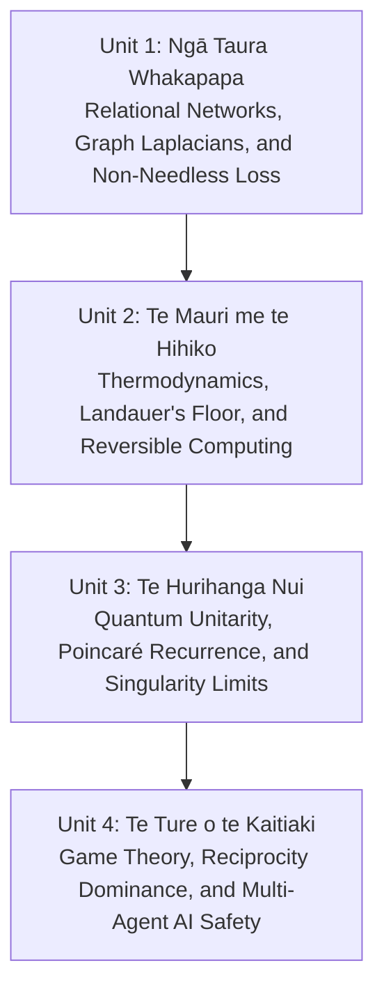

# Te Whare Wānanga o Mangakōtukutuku: Curriculum Series
### World-Class, Non-Commercial STEM & Relational Philosophy Resources
*Mangakōtukutuku College · Hamilton, Aotearoa New Zealand · Edition 1.0 (2026)*

---

## Kaupapa (Our Mission)

This curriculum series provides world-class, rigorous, non-commercial educational resources designed specifically for the students, teachers, and whānau of **Mangakōtukutuku College**.

The resources are built upon three unwavering pillars:
1. **Vertical Intellectual Depth:** We do not dumb down advanced concepts. We introduce secondary students directly to frontier mathematics, theoretical physics, discrete graph theory, and artificial intelligence safety.
2. **Constant Cultural Connection:** Every scientific principle is grounded in **Te Ao Māori**—drawing living parallels between quantum non-separability and *Whakapapa*, thermodynamic conservation and *Tapu/Noa/Utu*, cosmic recurrence and *Te Kore/Te Ao Mārama*, and multi-agent alignment and *Kaitiakitanga/Rangatiratanga*.
3. **Pono (Absolute Mathematical Integrity):** Distinguishing clearly between proven mathematical theorems, physical laws, and ethical imperatives.

---

## The Four Foundational Units

### [Unit 1: Ngā Taura Whakapapa (The Relational Web)](./UNIT-01-NGA-TAURA-WHAKAPAPA.md)
* **Core Topics:** Bounded Causal Relational Dynamics (BCRD P1–P4), Graph Theory (Adjacency & Laplacian matrices), Quantum Entanglement ($\rho_A \neq \rho_{AB}$), and Proposition 3 (Full Scope Forced / No Needless Loss).
* **Te Ao Māori:** *Whakapapa* as the fundamental non-separable architecture of existence.

### [Unit 2: Te Mauri me te Hihiko (Energy, Entropy, and Erasure)](./UNIT-02-TE-MAURI-ME-TE-HIHIKO.md)
* **Core Topics:** The First and Second Laws of Thermodynamics ($dU = \delta Q - \delta W$, $\Delta S \ge 0$), Landauer's Principle ($\mathcal{Q} \ge k_B T \ln 2$), and Charles Bennett's discovery of reversible computing using Toffoli gates.
* **Te Ao Māori:** *Mauri* (conservation of vital energy) and *Tapu / Noa / Utu* (the physical cost and balance of actions).

### [Unit 3: Te Hurihanga Nui (The Great Cycle)](./UNIT-03-TE-HURIHANGA-NUI.md)
* **Core Topics:** The Schrödinger equation, Hermitian Hamiltonians ($\hat{H}^\dagger = \hat{H}$), Unitary evolution ($\hat{U}^\dagger \hat{U} = \mathbb{I}$), Quantum Poincaré Recurrence, and physical analysis of gravitational collapse (Schwarzschild radius $r_s$, degeneracy pressure, and regular quantum horizons).
* **Te Ao Māori:** *Te Kore, Te Pō, ki Te Ao Mārama*—continuous generation and the impossibility of absolute oblivion.

### [Unit 4: Te Ture o te Kaitiaki (The Law of the Guardian)](./UNIT-04-TE-TURE-O-TE-KAITIAKI.md)
* **Core Topics:** The Iterated Prisoner's Dilemma, Axelrod's tournament, Reciprocity Dominance (§15.2: preserving those who preserve you strictly dominates defection), the Reach-Before-Harm wave-race inequality ($r > v_{\text{harm}}(\tau_{\text{resp}} + r/v_{\text{signal}})$), and safe multi-agent AI alignment.
* **Te Ao Māori:** *Rangatiratanga* (leadership as weaving people together) and *Kaitiakitanga* (unconditional guardianship of the web).

---

## Pedagogical Structure of Each Unit

Every document in this series follows a consistent wānanga structure:
* **Kupu Arataki:** Intuitive, grand-challenge introduction connecting daily experience to deep physics.
* **Ngā Tūāpapa:** Formal mathematical theorems, matrix equations, and physical derivations.
* **Te Ao Māori:** Authentic philosophical analysis demonstrating how ancestral concepts mirror frontier science.
* **Ngā Pātai Whakaaro:** Socratic discussion questions for classroom wānanga.
* **Ngā Mahi Tātai:** Quantitative calculation exercises for advanced mathematics and physics students.

---

## Open Source & Non-Commercial License

These educational resources are dedicated to the public good and distributed under the **Creative Commons Attribution-NonCommercial-ShareAlike 4.0 International License (CC BY-NC-SA 4.0)**.

* Free to use, adapt, and teach in any non-commercial educational institution.
* Commercial exploitation, paywalling, or privatization is strictly prohibited.

*Mā te mōhio ka mārama, mā te mārama ka mātau, mā te mātau ka ora.*  
*(Through knowledge comes understanding, through understanding comes wisdom, through wisdom comes life and well-being.)*

