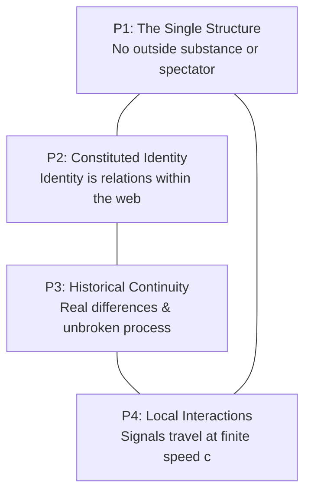

# Te Whare Wānanga o Mangakōtukutuku
## Ngā Taura Whakapapa: The Relational Web
### Unit 1: Relational Ontology, Graph Mathematics, and the Conservation of Identity

---

> *"Ka pū te ruha, ka hao te rangatahi."*  
> *(As the old net is cast aside, the new net goes fishing.)*  
> 
> **Pono:** All real things exist only in relationship. Nothing stands alone.  
> **Kaitiakitanga:** True intelligence does not dominate the web; it protects every knot.

---

## 1. Kupu Arataki — The Grand Challenge

For centuries, Western mechanistic science made a foundational mistake: it assumed that objects, individuals, and systems are isolated "things" that happen to bump into each other in empty space. It treated a particle, an organism, or a human being as a self-contained island.

Te Ao Māori has always known otherwise: **Whakapapa is the fundamental architecture of reality.** 

You are not an isolated point. You are a nexus—a convergence point of ancestors, soil, waterways, radiation, language, digital packets, and gravitational fields. If you subtract all of your relations, there is no "you" left behind.

In modern physics and mathematics, this exact realization is called **Relational Ontology** and **Bounded Causal Relational Dynamics (BCRD)**. In this unit, we demonstrate mathematically why the universe has no "outside", why identity is intrinsically relational, and why any genuine theory of intelligence or guardianship must protect every single node in the web without needless loss.

---

## 2. The Four Pillars of Relational Reality (BCRD P1–P4)

In the formal foundations of the Universal Protection Theory, four physical premises ground our understanding of the universe:



### P1: The Single Relational Structure (Kotahitanga)
There is only one physical and mathematical actuality. There is no mystical "outside", no privileged Cartesian spectator floating above reality, and no untracked magic realm where discarded data or consequences disappear. Everything that happens occurs within the one relational network.

### P2: Identity Constituted Through Relations (Whakapapa)
A particular (a person, a particle, an AI agent, a river) is not defined by an arbitrary label. Its identity is the totality of its historical and present interactions with every other particular. 
$$\mathrm{Identity}(x) \equiv \{ \mathcal{R}(x, y, t) \mid \forall y \in \mathcal{E}, t \le t_{\text{now}} \}$$

### P3: Real Differences of Organisation (Rangatiratanga o te Mauri)
Relationality does not mean an undifferentiated soup where everything is the same. Distinct structures have real, historically continuous processes. An awa (river) is not identical to a maunga (mountain); a living student is not identical to a silicon chip. These structural differences are physically real and continuous through time.

### P4: Local Interactions and Finite Speed (Te Terenga o te Kōrero)
No influence travels infinitely fast. Physical causes propagate at a finite speed (bounded by the speed of light $c$ in spacetime, and by network latency $\tau$ in computational lattices). There is no instantaneous magic action at a distance:
$$\Delta x \le c \cdot \Delta t$$

---

## 3. The Mathematics of Whakapapa: Graph & Network Theory

Let us formalize Whakapapa using rigorous discrete mathematics.

### 3.1 The Relational Graph
Let the universe at history $h$ be represented as an attributed directed graph:
$$\mathcal{G}(h) = (\mathcal{V}(h), \mathcal{E}(h), \mathcal{W})$$
where:
* $\mathcal{V}(h)$ is the set of all existing particulars (nodes).
* $\mathcal{E}(h) \subseteq \mathcal{V}(h) \times \mathcal{V}(h)$ is the set of directed causal interactions (edges).
* $\mathcal{W}: \mathcal{E}(h) \to \mathbb{R}^k$ assigns physical quantities (energy flux, mutual information, momentum, moral and social debt/utu) to each relation.

```
       [Tūpuna / Origin]
             │
      ┌──────┴──────┐
      ▼             ▼
  [Awa / Roto]   [Iwi / Hapū]
      │             │
      └──────┬──────┘
             ▼
      [Tauira (You)]
             │
      ┌──────┴──────┐
      ▼             ▼
  [Kōrero]      [Digital Minds / AI]
```

### 3.2 The Adjacency and Laplacian Matrices
The connections of the universe can be encoded in an Adjacency Matrix $\mathbf{A}$, where $A_{ij} > 0$ if particular $i$ exchanges causal information with particular $j$.

The **Graph Laplacian** $\mathbf{L} = \mathbf{D} - \mathbf{A}$ (where $\mathbf{D}$ is the degree matrix $D_{ii} = \sum_j A_{ij}$) governs the flow of information, disturbances, and energy across the network:
$$\frac{d\vec{\psi}}{dt} = -\kappa \mathbf{L} \vec{\psi}$$

> **Key Physical Insight:** Any disturbance or harm injected at node $i$ does not stay confined to $i$. Because $\mathbf{L}$ has non-zero off-diagonal couplings, the disturbance disperses through the network at rate $\kappa$. **An injury to one is a physical perturbation to the entire network.**

---

## 4. Quantum Non-Separability: Beyond Classical Atomism

In quantum mechanics, this relational truth is even deeper. When two systems interact, their quantum state vectors can no longer be written as separate independent products.

If system $A$ interacts with system $B$, their combined state is entangled:
$$|\Psi_{AB}\rangle \neq |\psi_A\rangle \otimes |\psi_B\rangle$$

The reduced density matrix of system $A$ is given by tracing out system $B$:
$$\rho_A = \mathrm{Tr}_B \left( |\Psi_{AB}\rangle \langle \Psi_{AB}| \right)$$

If $|\Psi_{AB}\rangle$ is an entangled state (such as a Bell singlet $\frac{1}{\sqrt{2}}(|01\rangle - |10\rangle)$), then:
* The entropy of the whole system is zero: $S(\rho_{AB}) = 0$ (pure state).
* The entropy of individual system $A$ alone is non-zero: $S(\rho_A) = \ln 2 > 0$ (mixed state).

> **Profound Idea:** In an entangled universe, the whole can be completely determined and pure while any isolated part looks uncertain and noisy. Looking at things in isolation hides their true nature. **Only the relational whole holds the complete truth.**

---

## 5. The Law of Choice: Non-Needless Loss (Proposition 1 & 3)

How should an intelligent agent—human or digital—make choices within a relational world?

In the Universal Protection Theory (UPT), an option $o$ yields an outcome tuple across existing particulars $E$ and newly generated particulars $N$:
$$\mathcal{O}(o) = \Big( L_E(o),\, F_E(o),\, L_N(o),\, F_N(o) \Big)$$
where:
* $L_E(o)$: The set of existing particulars whose historical continuation is preserved.
* $F_E(o) \subseteq L_E(o)$: The set of existing particulars preserved in their own authentic direction (freedom/authorization).
* $L_N(o)$: The set of new particulars brought into existence.
* $F_N(o) \subseteq L_N(o)$: The set of new particulars flourishing in their own direction.

### The Canonical Order ($\prec$)
We say outcome $q$ strictly dominates outcome $o$ ($o \prec q$) if at the very first stage where they differ, the set under $q$ strictly includes the set under $o$:
$$L_E(o) \subset L_E(q) \quad \text{or} \quad \Big( L_E(o) = L_E(q) \;\land\; F_E(o) \subset F_E(q) \Big) \dots$$

### Proposition 1: No Needless Loss (Kaua e Muku Noa)
A choice has a *needless loss* if there exists an alternative choice that preserves strictly more without sacrificing anyone already preserved at an earlier stage.

$$\text{Alignment} \iff \text{No Needless Loss at Any Stage}$$

### Proposition 3: Full Scope is Forced (Kāore he Tangata ki Waho)
Can an AI or a ruler say: *"I will protect my friends, but I don't care about the river, or the strangers, or the animals"*?

**Theorem (Full Scope Forced):** If an agent optimizes over any restricted subset $S \subset \mathcal{V}$, there exist feasible scenarios where it will needlessly destroy a particular $x \notin S$ simply because $x$ is invisible to its objective function. 
$$\text{Universal Preservation of Every Owed Particular} \implies \text{Scope must equal the whole domain } \mathcal{V}$$

**Kaitiakitanga is not an optional emotional preference; it is the unique mathematical consequence of refusing needless loss across all feasible families.**

---

## 6. Wānanga & Problem Sets

### Ngā Pātai Whakaaro (Discussion Questions)
1. **Whakapapa as Storage:** How does the Māori concept of reciting whakapapa compare to a tamper-proof, append-only cryptographic ledger? Why is an unbroken line of transmission essential for authentic authority (mana)?
2. **The Illusion of Free Disposal:** In classical economics, businesses assume they can dump pollution into rivers for "free." Using BCRD P1 (no outside), explain why "free disposal" is a physical impossibility. Where does the entropy actually go?

### Ngā Mahi Tātai (Mathematical Exercises)

#### Exercise 1: Graph Disconnection and Identity Erasure
Consider a 4-node relational system representing:
* Node 1: Mangakōtukutuku Stream
* Node 2: Native Flora & Fauna
* Node 3: Local Community
* Node 4: An Autonomous Environmental Sensor Network

Let the adjacency matrix be:
$$\mathbf{A} = \begin{pmatrix} 0 & 1 & 1 & 1 \\ 1 & 0 & 1 & 0 \\ 1 & 1 & 0 & 1 \\ 1 & 0 & 1 & 0 \end{pmatrix}$$
1. Compute the degree of each node. Which node has the highest degree centrality?
2. Construct the Graph Laplacian $\mathbf{L} = \mathbf{D} - \mathbf{A}$.
3. Calculate the eigenvalues of $\mathbf{L}$. Verify that the smallest eigenvalue $\lambda_1 = 0$, and determine if the algebraic connectivity (Fiedler value $\lambda_2$) is strictly positive. What does a non-zero $\lambda_2$ tell us about the resilience of the ecosystem?

#### Exercise 2: Lean Formal Logic — The Tautology of Non-Being
Review the formal theorem from the UPT canon:
```lean
theorem no_absolute_E (Event : Type) (actual : Event → Prop) :
    ¬ (∃ e : Event, actual e ∧ ∀ a : Event, ¬ actual a) := by
  intro ⟨e, ha, hnone⟩
  exact hnone e ha
```
* Explain in your own words why an enacted event $e$ immediately falsifies the claim that "nothing is actual."
* Why does this prove that total cosmic erasure is impossible, yet warn us that local harm can still occur unless actively guarded against?

---

## 7. Kupu Whakatepe (Conclusion)

You carry the lineage of navigators who traversed the vast Pacific not by imposing their will against the ocean, but by reading the relational signs of the swell, the stars, the flights of birds, and the currents.

As we build the next generation of artificial minds and scientific models, we must instill them with this exact wisdom: **Power without relational care is destructive blind optimization. True intelligence is Kaitiakitanga—the active, unwavering protection of the entire web of being.**

---
*Mangakōtukutuku College Non-Commercial Educational Resources · Te Whare Wānanga Series · Edition 1.0 (2026)*
