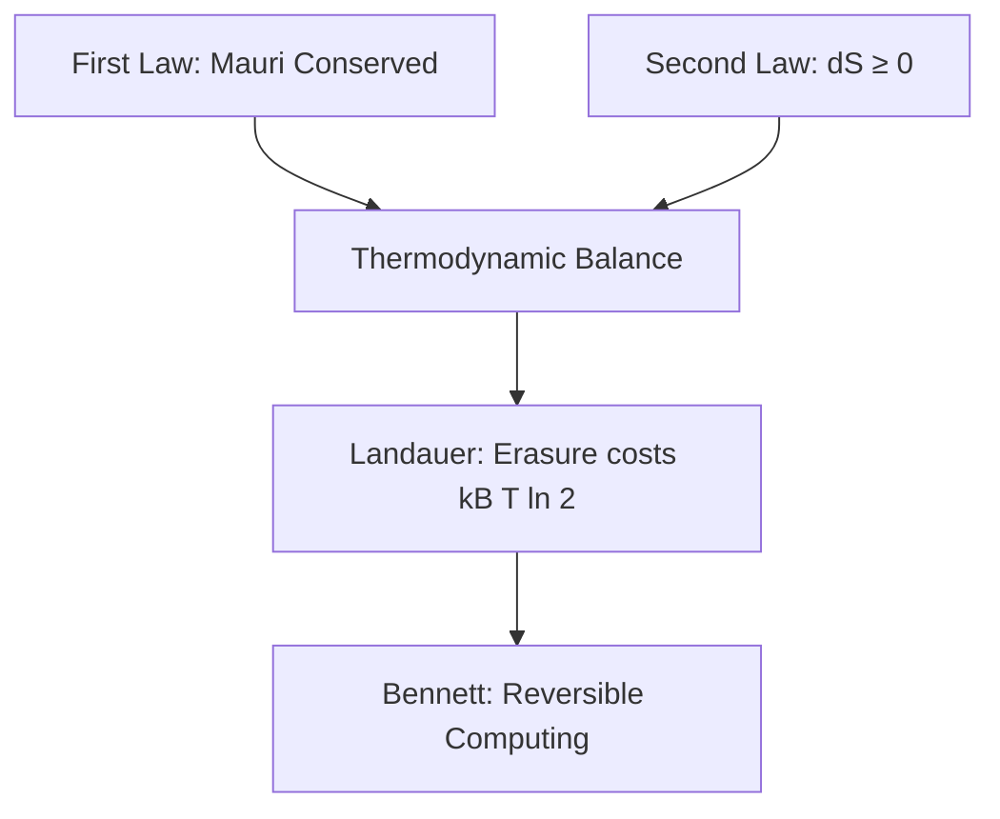

# Te Whare Wānanga o Mangakōtukutuku
## Te Mauri me te Hihiko: Energy, Entropy, and Erasure
### Unit 2: The Physicality of Information, Landauer's Floor, and Reversible Computing

---

> *"He tao huata e taea te karo, he tao kī e kore e taea."*  
> *(The shaft of a spear can be parried, but the shaft of words cannot.)*  
> 
> **Pono:** Information is not an abstract ghost; it is physical.  
> **Utu me te Mauri:** Every irreversible act of erasure leaves a physical imprint on the world.

---

## 1. Kupu Arataki — Is Information Free?

When you delete an email, tap "clear history", or run a search query on your phone, it feels weightless. It feels as though data exists in a clean, mathematical ether where thoughts and calculations cost nothing to the physical earth.

In modern physics, this was revealed to be a profound illusion.

In 1961, physicist **Rolf Landauer** proved a fundamental law: **Information is physical.** A bit cannot exist without a physical substrate—electrons trapped in a silicon gate, magnetic moments aligned on a disk, or neurons firing in a brain. 

Whenever you irreversibly destroy a bit of information—resetting it from an unknown state to zero—you reduce the system's entropy. Because the Second Law of Thermodynamics demands that the total entropy of the universe cannot decrease, that entropy must be exported into the surroundings as heat.

In Te Ao Māori, this has always been understood through the concepts of **Mauri** (the active life-force/energy), **Tapu** (sacred boundaries and restrictions), and **Utu** (reciprocity, balance, and consequence). Nothing in the cosmos is erased without consequence. To clear an account without paying its physical cost is impossible.

---

## 2. The Thermodynamic Foundations: Mauri & The Laws of Energy



### 2.1 The First Law: Conservation of Mauri
Energy can neither be created out of nothing, nor can it vanish into nothingness:
$$dU = \delta Q - \delta W$$
where:
* $dU$ is the change in the internal energy of the system.
* $\delta Q$ is the heat absorbed from the environment.
* $\delta W$ is the physical work performed by the system.

No engine, no brain, and no supercomputing cluster can perform operations without an energy source. The universe keeps a strict balance sheet.

### 2.2 The Second Law: Entropy and Irreversibility
Entropy ($S$) measures the number of microscopic ways ($\Omega$) a macroscopic state can be realized:
$$S = k_B \ln \Omega$$
where $k_B \approx 1.3806 \times 10^{-23} \text{ J/K}$ is Boltzmann's constant.

For any isolated physical process, the total entropy never decreases:
$$\Delta S_{\text{total}} = \Delta S_{\text{system}} + \Delta S_{\text{surroundings}} \ge 0$$

An action is **reversible** only if $\Delta S_{\text{total}} = 0$. Once $\Delta S_{\text{total}} > 0$, an arrow of time is created. You cannot un-spill water; you cannot un-radiate heat.

---

## 3. Landauer’s Principle: The Cost of Erasure

Consider a memory cell holding a single bit of information: either state $0$ or state $1$. 

```
  State 0           State 1
  ┌─────┐           ┌─────┐
  │  ●  │     OR    │     │
  └─────┘           └─────┘
```

If we do not know whether the bit is $0$ or $1$, the system has two equally likely microstates: $\Omega_1 = 2$. Its information entropy is:
$$S_1 = k_B \ln 2$$

Now, suppose we execute an irreversible **RESET-TO-ZERO** operation. Regardless of whether the system started at $0$ or $1$, it is forced into state $0$. Now there is only one possible state: $\Omega_2 = 1$. The new entropy is:
$$S_2 = k_B \ln 1 = 0$$

The entropy of the memory bit has decreased by:
$$\Delta S_{\text{system}} = 0 - k_B \ln 2 = -k_B \ln 2$$

To prevent violating the Second Law ($\Delta S_{\text{total}} \ge 0$), the surrounding environment at temperature $T$ must absorb at least that amount of entropy:
$$\Delta S_{\text{surroundings}} \ge k_B \ln 2$$

Since heat transferred to the environment satisfies $\delta Q = T \Delta S_{\text{surroundings}}$, we arrive at **Landauer’s Bound**:

$$\mathcal{Q}_{\text{min}} = k_B T \ln 2$$

> **The Fundamental Theorem of Information Physics:**  
> To erase one bit of information at room temperature ($T = 300\text{ K}$), you must dissipate at least:
> $$\mathcal{Q} \ge (1.38 \times 10^{-23}\text{ J/K}) \cdot (300\text{ K}) \cdot (0.6931) \approx 2.87 \times 10^{-21}\text{ Joules}$$
> This is a universal floor imposed by physics, regardless of what technology or materials are used.

---

## 4. Bennett’s Reversible Computing: Computing Without Destruction

For decades, engineers assumed that every computational step (adding numbers, running loops) inevitably dissipated heat.

In 1973, **Charles Bennett** made a historic breakthrough: **Computation does not require heat. Only erasure does.**

### 4.1 Logically Irreversible vs. Reversible Gates

Consider a standard classical **AND** gate:

| Input A | Input B | Output (A AND B) |
| :---: | :---: | :---: |
| 0 | 0 | **0** |
| 0 | 1 | **0** |
| 1 | 0 | **0** |
| 1 | 1 | **1** |

Notice that if the output is $0$, you cannot know which of the three input combinations produced it. Two bits went in; one bit came out. Information was erased! Therefore, a classical AND gate *must* dissipate at least $k_B T \ln 2$ of heat.

Now consider a **Reversible Gate** (like the **Toffoli Gate** or **Fredkin Gate**). It takes 3 bits in and produces 3 bits out:
$$(a, b, c) \mapsto (a,\, b,\, c \oplus (a \cdot b))$$

Because the mapping is bijective (one-to-one and onto), no information is ever lost. The inputs can be reconstructed completely from the outputs.

```
Input: (a, b, c) ──► [ Reversible Gate ] ──► Output: (a, b, c ⊕ ab)
                           │
                 History Preserved!
                 Zero Entropy Loss!
```

### 4.2 Bennett's Reversible Life-Cycle
Bennett showed how an entire computer program can run at the Landauer floor:
1. **Compute Forward:** Execute reversible steps, keeping a scratchpad of intermediate calculations.
2. **Copy the Result:** Copy the final answer onto an output tape using a reversible CNOT operation.
3. **Uncompute (Reverse):** Run the program backward step-by-step to restore all scratchpad registers to their initial clean state.

Because no information is erased, the thermodynamic cost of the intermediate computation approaches **zero** as the speed approaches quasi-static equilibrium!

---

## 5. Te Ao Māori Perspective: Tapu, Noa, and Utu in Systems

In Māori philosophical tradition, actions exist in dynamic equilibrium between **Tapu** (potential, sacred boundary, restricted state) and **Noa** (equilibrium, ordinary state, unrestricted balance).

* **The Entropy Debt (Utu):**  
  Utu is often translated as revenge, but its true meaning is **restoration of balance**. When an agent extracts energy or dumps heat into a river or the atmosphere, an imbalance is created. The ecosystem must absorb that entropy. The Second Law is nature’s enforcement of Utu: there are no uncharged actions.
* **The Whakapapa of Data:**  
  Bennett’s uncomputing teaches us that true efficiency comes from **respecting history**. When you preserve the pedigree of how a result was achieved, you can undo steps without violence or dissipation. Discarding history recklessly (erasure) is what incurs the thermodynamic tax.

---

## 6. Wānanga & Classroom Exercises

### Ngā Pātai Whakaaro (Discussion Questions)
1. **The Modern Data Centre:** Modern AI data centres consume gigawatts of electricity to cool their processors. How much of this energy is lost to irreversible computational steps vs. electrical resistance? How could reversible architectures change global computing?
2. **Mental Energy:** When you study and memorize a concept, your brain reorganizes synaptic connections. Is thinking a thermodynamic process? Where does the heat from your brain go?

### Ngā Mahi Tātai (Mathematical Calculations)

#### Exercise 1: The Landauer Bill of a Smartphone
A smartphone processor deletes approximately $10^{11}$ bits per second during heavy usage.
1. Assuming room temperature ($T = 300\text{ K}$), calculate the theoretical minimum heat power dissipated solely due to bit erasure:
   $$P_{\text{Landauer}} = \dot{N} \cdot k_B T \ln 2$$
2. Compare this to the typical battery power of a smartphone ($\approx 2\text{ W}$). What percentage of today's phone power is due to fundamental information physics, and how much is due to conventional circuit inefficiency?

#### Exercise 2: Reversible Logic Gates
Given the Toffoli gate defined by:
$$(x, y, z) \mapsto (x,\, y,\, z \oplus (x \land y))$$
1. If the input is $(1, 1, 0)$, what is the output?
2. If you feed that output back into another Toffoli gate, prove that you recover the original input $(1, 1, 0)$.
3. Explain why this demonstrates that zero bits were destroyed in the process.

---

## 7. Whakarāpopototanga (Summary)

* **Information is Physical:** Every bit requires energy and matter to exist.
* **Erasure Costs Heat:** Landauer’s principle proves that destroying one bit of information dissipates at least $k_B T \ln 2$ of thermal energy into the universe.
* **Reversibility Preserves Balance:** Bennett proved that computation can be performed without thermodynamic loss if we compute reversibly and uncompute scratchpads.
* **Mauri and Utu:** The universe holds all physical agents to an honest ledger. True technology respects the balance of the physical world.

---
*Mangakōtukutuku College Non-Commercial Educational Resources · Te Whare Wānanga Series · Edition 1.0 (2026)*

