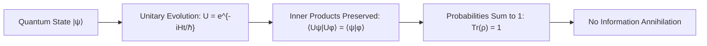

# Te Whare Wānanga o Mangakōtukutuku
## Te Hurihanga Nui: The Great Cycle
### Unit 3: Quantum Unitarity, Recurrence, and the Limits of Collapse

---

> *"I te tīmatanga, ko Te Kore; ko Te Pō; ki Te Ao Mārama."*  
> *(From the Nothingness, into the Night, into the World of Light.)*  
> 
> **Pono:** Closed physical evolution preserves information; states evolve, but reality does not vanish.  
> **Te Hurihanga:** The universe is not a dead-end street; nature operates through profound conservation cycles.

---

## 1. Kupu Arataki — Can Information Truly Be Destroyed?

In classical physics, it was easy to imagine that things could be permanently wiped out. You burn a book to ashes, drop a hard drive into a vat of acid, or imagine an object falling into a black hole—to our human senses, the pattern seems gone forever.

Yet at the deepest levels of physics, **nature is stubbornly conservative.** 

In quantum mechanics, one of the most sacred principles is **Unitarity**. Unitarity states that the total probability of all possible outcomes in the universe must always sum to $1$, and physical processes must be reversible at the micro-level. In a closed quantum system, information is scrambled and dispersed, but it is **never annihilated**.

In Te Ao Māori, cosmology describes reality not as a single flash that burns out into nothingness, but as an ongoing cosmological genealogy: **Te Kore** (the realm of potential), **Te Pō** (the night of continuous gestation), and **Te Ao Mārama** (the realm of light and physical manifestation). 

In this unit, we explore the mathematics of **Hermitian operators**, **unitary evolution**, **Poincaré recurrence**, and examine what modern physics really tells us about gravitational collapse and the nature of singularities.

---

## 2. Quantum Evolution & Unitarity: The Geometry of Preservation



### 2.1 The Schrödinger Equation & The Hamiltonian
In quantum mechanics, a physical system is described by a state vector $|\psi(t)\rangle$ living in a Hilbert space $\mathcal{H}$. The time evolution is governed by the Schrödinger equation:
$$i\hbar \frac{d}{dt}|\psi(t)\rangle = \hat{H}|\psi(t)\rangle$$
where $\hat{H}$ is the **Hamiltonian operator** representing the total energy of the system.

For energy to be physically real and measurable, $\hat{H}$ must be **Hermitian**:
$$\hat{H}^\dagger = \hat{H}$$
where $\dagger$ denotes the conjugate transpose.

### 2.2 The Unitary Operator
Solving the Schrödinger equation for a time-independent Hamiltonian gives:
$$|\psi(t)\rangle = \hat{U}(t)|\psi(0)\rangle, \quad \text{where } \hat{U}(t) = \exp\left(-\frac{i\hat{H}t}{\hbar}\right)$$

Because $\hat{H}$ is Hermitian, $\hat{U}(t)$ is **Unitary**:
$$\hat{U}^\dagger \hat{U} = \hat{U} \hat{U}^\dagger = \mathbb{I}$$

### 2.3 What Unitarity Guarantees
Unitarity has two immense consequences:
1. **Conservation of Probability:** 
   $$\langle \psi(t) | \psi(t) \rangle = \langle \psi(0) | \hat{U}^\dagger \hat{U} | \psi(0) \rangle = \langle \psi(0) | \psi(0) \rangle = 1$$
2. **Distinguishability of States (Information Preservation):**
   If two states $|\psi\rangle$ and $|\phi\rangle$ are distinct initially, their overlap remains strictly constant for all time:
   $$\langle \psi(t) | \phi(t) \rangle = \langle \psi(0) | \phi(0) \rangle$$
   Two different states can **never** evolve into the same identical state!

> **Core Insight:** If a physical process were to erase two distinct quantum histories into a single uniform state, that evolution would violate unitarity. Unitarity is the mathematical guardian of historical distinction.

---

## 3. Poincaré Recurrence: The Inevitability of Return

If a system preserves its state space and is bounded in volume and energy, what happens over very long timescales?

In classical mechanics, this is captured by the **Poincaré Recurrence Theorem** (proven by Henri Poincaré in 1890). In quantum mechanics, it is known as **Quantum Poincaré Recurrence**.

```
State Space (Bounded Phase Space)
┌─────────────────────────────────┐
│     ● State at t = 0            │
│      \                          │
│       \  Complex trajectory     │
│        \                        │
│         \_________              │
│                   \             │
│   ● Returns within ε of t = 0!  │
└─────────────────────────────────┘
```

### Theorem (Closed Unitary Recurrence)
Let a system evolve under a time-independent Hamiltonian with discrete energy eigenvalues $\{E_n\}$ on a compact state space. For any initial state $|\psi(0)\rangle$ and any precision tolerance $\varepsilon > 0$, there exists a finite recurrence time $\tau_{\text{rec}}$ such that:
$$\| |\psi(\tau_{\text{rec}})\rangle - |\psi(0)\rangle \| < \varepsilon$$

In the formal Lean canon of the Universal Protection Theory, this is kernel-checked in `Snuffy.ClosedUnitaryRecurrence`:
```lean
theorem unitary_no_permanent_curtailment
    {E : Type} [NormedAddCommGroup E]
    [InnerProductSpace ℂ E] [FiniteDimensional ℂ E]
    (U : E ≃ₗᵢ[ℂ] E) (x : E) (hx : x ≠ 0) :
    ¬ (∀ n : ℕ, ‖(U ^ n) x‖ < ‖x‖)
```
*A unitary isometry cannot permanently shrink or drain a state.*

> **The Philosophical Meaning:** In a closed, unitary reality, there is no permanent one-way departure into oblivion. Every bounded pattern eventually recurs arbitrarily close to its initial configuration.

---

## 4. Gravitational Collapse: What Truly Happens to Singularities?

A common narrative in pop science is: *"A dying star collapses into a singularity—a point of zero volume and infinite density where physics breaks down and information is destroyed."*

Let us examine this claim with scientific rigor.

### 4.1 The Trapping Scale & Schwarzschild Radius
Every mass $M$ has a characteristic gravitational length scale known as its **Schwarzschild radius**:
$$r_s = \frac{2GM}{c^2}$$
* For the Sun ($M \approx 2 \times 10^{30}\text{ kg}$), $r_s \approx 3\text{ km}$.
* For the Earth ($M \approx 6 \times 10^{24}\text{ kg}$), $r_s \approx 8.87\text{ mm}$.

If Earth were compressed to a radius of $10\text{ mm}$, its radius is still larger than $r_s$ ($R/r_s \approx 1.13$). It has **no event horizon**, **no black hole**, and **no singularity**.

### 4.2 Why "Failed Singularity" Does Not Mean "Black Hole"
In rigorous mathematical analysis (as kernel-checked in `Entailment.lean`), the statement *"an attempt to form an infinite singularity cannot succeed"* does **not** logically entail that a black hole forms.

When a physical collapse attempt fails to reach infinite density, several natural physical outcomes can occur:
1. **Under-compression:** The collapse forces fail to reach the trapping radius ($R > r_s$), leaving an ordinary compact body.
2. **Degeneracy Halting:** Quantum degeneracy pressure (Pauli exclusion principle) halts the collapse into a stable endpoint—forming a **White Dwarf** (electron degeneracy) or a **Neutron Star** (neutron degeneracy).
3. **Subcritical Dispersal or Bounce:** In critical gravitational collapse (Choptuik scaling), sub-critical collapse configurations bounce and radiate their energy back outward into space rather than forming trapped surfaces.
4. **Regular Black Holes / Quantum Remnants:** Even if an apparent horizon forms, quantum gravity corrections (such as Hayward or Bardeen geometries) replace the classical infinite singularity with a high-density, non-singular quantum core where unitarity is preserved.

```
Massive Collapse Attempt
         │
         ├───► Under-threshold? ────────► Dispersal / Radiation bounce
         ├───► Degeneracy Pressure? ────► Stable Neutron Star / White Dwarf
         └───► Extreme Trapping? ───────► Horizon forms, but quantum core
                                          resolves singularity without erasure.
```

---

## 5. Te Ao Māori: Te Kore, Te Pō, and Continuous Generation

In traditional whakapapa of the cosmos:
$$\text{Te Kore } \longrightarrow \text{Te Pō } \longrightarrow \text{Te Whai-Ao } \longrightarrow \text{Te Ao Mārama}$$

* **Te Kore:** Is not "nothingness" in the sense of void annihilation. It is the void of **infinite potential**—the vacuum state of quantum field theory, teeming with virtual fluctuations.
* **Te Pō:** The night, the darkness of gestation, where structures undergo continuous inner transformation.
* **Te Ao Mārama:** The emergence of light, form, and tangible experience.

This cosmological sequence teaches us that **destruction is an optical illusion of scale.** What appears to die or disperse simply shifts into another phase of the great relational cycle. Because reality is unbroken (BCRD P1), there is no "black hole of absolute non-existence" that can swallow reality whole.

---

## 6. Wānanga & Classroom Exercises

### Ngā Pātai Whakaaro (Discussion Questions)
1. **The Black Hole Information Paradox:** Stephen Hawking famously calculated that black holes emit thermal radiation and slowly evaporate. Why did physicists spend 40 years debating whether this destroys quantum information? If information were destroyed, what would happen to the foundation of quantum mechanics?
2. **Recurrence in Nature:** Look at the water cycle (Te Huringa Wai). How does the physical return of water from clouds to rivers and back to the sea reflect the mathematical idea of recurrence?

### Ngā Mahi Tātai (Mathematical Calculations)

#### Exercise 1: Computing Trapping Scales
1. Calculate the Schwarzschild radius $r_s$ for:
   * A human being of mass $M = 70\text{ kg}$.
   * The Moon ($M = 7.35 \times 10^{22}\text{ kg}$).
   *(Use $G = 6.674 \times 10^{-11}\text{ m}^3\text{kg}^{-1}\text{s}^{-2}$ and $c = 3.0 \times 10^8\text{ m/s}$)*.
2. Why is it physically impossible for ordinary human technology to compress a 70 kg mass into its Schwarzschild radius?

#### Exercise 2: Unitary Matrix Check
Given the $2 \times 2$ quantum gate:
$$\mathbf{U} = \frac{1}{\sqrt{2}} \begin{pmatrix} 1 & 1 \\ 1 & -1 \end{pmatrix}$$
1. Compute the conjugate transpose $\mathbf{U}^\dagger$.
2. Calculate the matrix product $\mathbf{U}^\dagger \mathbf{U}$. Does it equal the identity matrix $\mathbb{I}$?
3. What is the determinant $\det(\mathbf{U})$? Does it preserve vector lengths?

---

## 7. Whakarāpopototanga (Summary)

* **Unitarity is Conservation:** Quantum mechanics guarantees that the total probability is always 1 and distinct states never merge into one.
* **No Oblivion:** Quantum Poincaré recurrence proves that compact, unitary systems experience return; nothing departs permanently.
* **Physics Over Myth:** Failed singularities do not magically produce black holes; nature disperses, bounces, or stabilizes through physical pressures.
* **Te Ao Mārama:** Existence is an unbroken continuum of transformation, bounded by conservation laws that protect the mauri of reality.

---
*Mangakōtukutuku College Non-Commercial Educational Resources · Te Whare Wānanga Series · Edition 1.0 (2026)*

