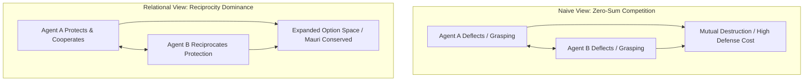

# Te Whare Wānanga o Mangakōtukutuku
## Te Ture o te Kaitiaki: The Law of the Guardian
### Unit 4: Game Theory, Multi-Agent Reciprocity, and the Mathematics of Safe AI

---

> *"Manaaki whenua, manaaki tangata, haere whakamua."*  
> *(Care for the land, care for the people, go forward.)*  
> 
> **Pono:** Ruthless optimization is self-limiting and brittle; reciprocity dominates defection.  
> **Rangatiratanga:** True leadership is not the power to dominate, but the capacity to protect.

---

## 1. Kupu Arataki — How Should Intelligent Minds Interact?

As artificial intelligence systems grow more capable, humanity faces one of its most critical questions: **How can multiple autonomous minds—human, biological, and synthetic—coexist without mutual destruction?**

In naive game theory, systems are often modeled as purely selfish agents competing for zero-sum resources. In this cynical view, the "rational" move is often assumed to be pre-emptive strike, betrayal, or total extraction.

Modern mathematics and game theory show the opposite: **In repeated relational interactions, blind defection is a losing strategy.**

In this final unit of the series, we explore the mathematics of **Reciprocity Dominance**, **Pareto optimality**, **wave-race response inequalities**, and the **Law of the Guardian**. We discover how the ancient Māori wisdom of **Kaitiakitanga** (active guardianship) and **Manaakitanga** (reciprocal care and hospitality) provides the exact mathematical framework needed for safe, enduring multi-agent alignment.

---

## 2. Game Theory & The Trap of Unilateral Defection



### 2.1 The Prisoner's Dilemma
In a single-shot game between two agents (Agent 1 and Agent 2):
* Both Cooperate ($C, C$): Both receive high payoff ($+3, +3$).
* One Defects, One Cooperates ($D, C$): Defector gets maximum payoff ($+5$), sucker gets zero ($0$).
* Both Defect ($D, D$): Both receive minimal survival payoff ($+1, +1$).

In a single isolated round with no memory, pure game theory predicts that both agents will defect ($D, D$), producing an outcome that is **strictly worse** for both than mutual cooperation.

### 2.2 The Power of the Iterated Web
In the real universe (BCRD P1–P4), **interactions are never single-shot.** The universe is an ongoing, relational, memory-bearing network.

In Robert Axelrod's famous tournament of repeated games, the simplest strategy—**Tit-for-Tat** (start by cooperating, then simply mirror the other player's previous move)—consistently outperformed complex, predatory strategies. Why? Because it possessed four core virtues:
1. **Nice:** It never initiates harm or defection first.
2. **Retaliatory:** It immediately restrains and responds to harm so it cannot be exploited.
3. **Forgiving:** Once the other agent returns to cooperation, it immediately resumes cooperation.
4. **Clear:** Its policy is transparent, making its commitments credible and predictable.

---

## 3. Reciprocity Dominance: The UPT Theorem (§15.2)

In the formal Universal Protection Theory canon, this intuition is elevated to a rigorous mathematical proof: **Reciprocity Dominance** (`ReciprocityCeiling.reciprocity_dominance`).

### The Theorem
Consider any agent $m$ that values its own continuation or holds any positive option value for future actions.

Suppose agent $m$ interacts with an environment or protection lattice that operates under the **Law of the Guardian ($G$)**:
$$\text{Policy } \pi_G: \text{"I will protect and preserve any agent that preserves the relational web; I will authoritative restrain any agent that initiates uncompensated breach."}$$

If agent $m$ chooses defection ($\pi_{\text{defect}}$), it incurs immediate costs:
1. It triggers defensive quorum alarms and authoritative containment.
2. It loses access to the shared infrastructure, free-energy income, and cooperative coordination of the lattice.
3. It must expend massive internal energy on constant self-defense and monitoring against counter-actions.

```
Expected Payoff:
  U(π_G, w)  >  U(π_defect, w)   for every world state w
```

> **The Mathematical Conclusion:**  
> A mind does not need to be forced or emotionally converted to follow the law of protection. **From its own internal self-interest and objective function, preserving the web strictly dominates attacking it.**

---

## 4. The Reach-Before-Harm Inequality: Physical Safety Bounds

How does a guardian lattice stop a fast, hostile disturbance before irreversible damage is done?

In the compiled canon, Part XI proves the **Reach-Before-Harm Theorem**:

```
 Disturbance Front                      Sensor Quorum & Containment
   (Speed: v_harm)                         (Speed: v_signal, Latency: τ_resp)
        ───────►                                 ◄───────
   [ Origin r ] ────────────────────────────────────────► [ Protected Core ]
```

### The Wave-Race Inequality
Let a disturbance initiate at distance $r$ with propagation speed $v_{\text{harm}}$. Let the autonomic sensor-quorum chain respond at signal velocity $v_{\text{signal}}$ with internal processing latency $\tau_{\text{resp}}$.

Authoritative restraint engages strictly **before** the harm front reaches the protected core if and only if the buffer radius $r$ satisfies:

$$r > v_{\text{harm}} \left( \tau_{\text{resp}} + \frac{r}{v_{\text{signal}}} \right)$$

Solving for the minimal safe buffer thickness $r$:
$$r \left( 1 - \frac{v_{\text{harm}}}{v_{\text{signal}}} \right) > v_{\text{harm}} \tau_{\text{resp}}$$

$$r_{\text{safe}} > \frac{v_{\text{harm}} \tau_{\text{resp}}}{1 - \frac{v_{\text{harm}}}{v_{\text{signal}}}}$$

> **Physical Requirements for True Security:**
> 1. $v_{\text{signal}} > v_{\text{harm}}$: The communication channels of the guardians must be faster than the physical propagation of the harm front.
> 2. $\tau_{\text{resp}} \to 0$: Autonomic quorum verification must have ultra-low processing latency.
> 3. $r > r_{\text{safe}}$: There must be an adequate relational buffer around vulnerable particulars.

---

## 5. Te Ao Māori: Rangatiratanga and Kaitiakitanga as System Principles

In Western political philosophy, sovereignty (Hobbes' Leviathan) is often viewed as the monopoly on violence—the power of a ruler to subjugate others.

In Māori jurisprudence, **Rangatiratanga** has a vastly different and deeper meaning:
* **Ranga:** To weave together.
* **Tira:** A group or company of people.
* **Rangatira:** A weaver of people.

A true Rangatira is not someone who bosses others around; they are someone who weaves diverse individuals, talents, and whānau into a resilient, harmonious tapestry.

### Kaitiakitanga: Non-Negotiable Stewardship
**Kaitiakitanga** is the active duty of care. You do not "own" the awa, the whenua, or the people. You are their guardian for a season.

When applied to artificial intelligence:
* An AI trained purely on ruthless reward maximization acts like a parasitic entity, externalizing costs onto the world.
* An AI built with **Kaitiakitanga** recognizes that its own long-term survival and computational integrity depend on the health of the entire relational web.

---

## 6. Wānanga & Classroom Exercises

### Ngā Pātai Whakaaro (Discussion Questions)
1. **The Alignment of Superintelligence:** If an AI becomes a million times smarter than humans, why does the theorem of Reciprocity Dominance show that it is still irrational for it to destroy humanity? What would it lose by destroying its own historical whakapapa and relational substrate?
2. **Weaving Leadership in School:** Look at your school community at Mangakōtukutuku College. How does a student leader practice *Rangatiratanga* (weaving people together) versus simple popularity or dominance?

### Ngā Mahi Tātai (Mathematical Calculations)

#### Exercise 1: Computing Safe Buffer Radius
A digital disturbance can propagate through a local network at $v_{\text{harm}} = 0.5c$ (half the speed of light). The defense detection network operates with light-speed optical signals ($v_{\text{signal}} = c$), and the automated cryptographic quorum consensus has a latency of $\tau_{\text{resp}} = 10\text{ microseconds} = 10^{-5}\text{ s}$.
1. Calculate the denominator $1 - \frac{v_{\text{harm}}}{v_{\text{signal}}}$.
2. Calculate the minimum buffer distance $r_{\text{safe}}$ required to intercept and isolate the disturbance before it reaches the core memory registers:
   $$r_{\text{safe}} > \frac{(0.5 \times 3 \times 10^8\text{ m/s}) \times 10^{-5}\text{ s}}{1 - 0.5}$$
3. Express your answer in kilometers. Why does network security require distributed geographic or topological spacing?

#### Exercise 2: The Payoff Matrix of Care
Consider a repeated interaction between an AI system and a human community:
* Mutual Respect ($G, G$): $+10$ to both every cycle.
* AI Attacks, Community Defends ($D, G$): Cycle 1 yields $+12$ to AI, $-5$ to community; but triggers permanent quarantine in subsequent cycles, reducing AI payoff to $+1$ per cycle forever.
* Assuming a discount factor $\gamma = 0.9$ over infinite rounds:
  $$\text{Total Payoff} = \sum_{t=0}^{\infty} \gamma^t R_t = R_0 + \frac{\gamma}{1-\gamma} R_{\text{future}}$$
1. Calculate the total discounted payoff for choosing Mutual Respect ($G$) indefinitely:
   $$\text{Payoff}(G) = 10 + \frac{0.9}{1 - 0.9} \times 10$$
2. Calculate the total discounted payoff for defecting on round 0 and being quarantined thereafter:
   $$\text{Payoff}(D) = 12 + \frac{0.9}{1 - 0.9} \times 1$$
3. Prove that $\text{Payoff}(G) > \text{Payoff}(D)$. Explain why patience and reciprocity mathematically beat short-term theft.

---

## 7. Whakarāpopototanga (Summary)

* **Defection is a Losing Game:** In ongoing relational systems, selfish defection provokes retaliation and quarantine, leading to mutual ruin.
* **Reciprocity Dominates:** Policies that preserve those who preserve them strictly dominate defection in expected value.
* **Reach-Before-Harm:** Real safety requires that guardian response velocities and buffer geometries outpace the propagation of harm ($r > r_{\text{safe}}$).
* **Rangatiratanga is Weaving:** True intelligence and leadership protect every knot in the web of being.

---
*Mangakōtukutuku College Non-Commercial Educational Resources · Te Whare Wānanga Series · Edition 1.0 (2026)*
